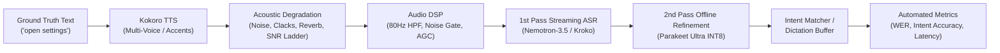

# Synthetic Round-Trip Evaluation & Acoustic Benchmark Suite

**VoxLab: The Voice Pipeline Test Bench for Web Runtimes**

---

## 1. Executive Summary & Vision

In production voice systems, manual microphone testing is slow, variable, and non-reproducible. Different physical rooms, microphones, distances, and accents introduce uncontrollable acoustic variables.

Because **VoxLab** already integrates both:
1. **High-Fidelity Neural Voice Generation (Kokoro TTS)** with over 100 voices across genders, accents, and languages, and
2. **Resident Real-Time Neural Speech Recognition (Nemotron-3.5 560ms / Kroko + Parakeet Ultra)** with DSP filtering and intent matching,

VoxLab implements a **Closed-Loop / Synthetic Round-Trip Acoustic Benchmark Harness**. The system synthesizes realistic speech audio across diverse speaker profiles, routes it through acoustic perturbation and DSP filters, and feeds it directly into the speech recognition and intent matching pipelines to measure objective accuracy and latency.

---

## 2. Two-Tier Test Suite Architecture

To maintain instant developer feedback loops while still supporting exhaustive acoustic validation, the evaluation framework is split into two operational tiers:

| Attribute | Tier 1: Fast Smoke Suite (CI) | Tier 2: Deep Acoustic Benchmark |
| :--- | :--- | :--- |
| **Utterance Count** | 5 curated golden cases | 50 – 100+ audio clips |
| **Execution Time** | **~15 – 20 seconds total** | 5 – 15 minutes |
| **Frequency** | Every `go test ./pkg/...` and commit | On-demand via CLI or Web UI button |
| **Acoustic Conditions** | Clean speech + sub-gate noise floor | SNR ladder (+20dB down to -5dB), keyboard typing, babble |
| **Voices Evaluated** | US Female (`af_heart`), US Male (`am_adam`), UK Female (`bf_emma`), Synthetic Noise | 10+ Kokoro voices, British/American/Multilingual, speaking rates 0.8x - 1.3x |
| **Primary Metric** | Pass/Fail on intent ID, rejection reason, WER | WER/CER degradation curve vs SNR, latency percentiles (p50, p95) |

---

## 3. Tier-1 Golden Test Cases

Located in `data/test_samples/eval/` with `manifest.json`:

1. **`T1_CMD_SETTINGS`**:
   - **Spoken Text**: `"open settings"`
   - **Voice**: `af_heart` (American English Female)
   - **Mode**: `command`
   - **Expected Outcome**: Intent matched as `NAV_SETTINGS` with high confidence ($\ge 0.85$).
2. **`T1_CMD_START_REC`**:
   - **Spoken Text**: `"start recording"`
   - **Voice**: `am_adam` (American English Male)
   - **Mode**: `command`
   - **Expected Outcome**: Intent matched as `START_RECORDING`.
3. **`T1_CMD_NEGATION`**:
   - **Spoken Text**: `"do not stop recording"`
   - **Voice**: `af_heart` (American English Female)
   - **Mode**: `command`
   - **Expected Outcome**: Rejection with reason `NEGATION_DETECTED` (safety suppression).
4. **`T1_DICT_BENCH`**:
   - **Spoken Text**: `"The voice pipeline test bench is operational and ready."`
   - **Voice**: `bf_emma` (British English Female)
   - **Mode**: `dictation`
   - **Expected Outcome**: Draft text created; second-pass Parakeet Ultra applies proper punctuation and casing; $\text{WER} = 0.00$.
5. **`T1_NOISE_GATE`**:
   - **Audio**: Low-level ambient white noise and typing transients ($-46\text{ dBFS}$, below gate threshold).
   - **Mode**: `command`
   - **Expected Outcome**: Attenuated/dropped by the noise gate; zero bogus partials; no false intent triggers.

---

## 4. Voice Input Language Selector

Multilingual voice input support is decoupled into two complementary layers:

1. **Browser Web Speech API (`SpeechRecognition`)**:
   - Standard browser recognition requires an explicit language tag (`recognition.lang`).
   - The UI provides a dynamic selector supporting `auto`, `en-US`, `en-GB`, `es-ES`, `fr-FR`, `de-DE`, `it-IT`, `pt-BR`, `ja-JP`, `zh-CN`, and `hi-IN`.
2. **Sherpa-ONNX Streaming Recognizer (Nemotron-3.5)**:
   - Trained on 40+ languages natively.
   - The active language code is communicated over WebSocket via `{"action": "set_language", "language": "es-ES"}` and synchronized across the host daemon and UI.

---

## 5. Quantitative Evaluation Metrics

The evaluation framework automatically computes:

1. **Word Error Rate (WER)**:
   $$\text{WER} = \frac{S + D + I}{N}$$
   where $S$ = substitutions, $D$ = deletions, $I$ = insertions, and $N$ = reference word count.
2. **Intent Accuracy & Rejection Precision**:
   - Percentage of valid commands mapped to the expected `intent_id`.
   - Rejection precision on adversarial inputs (negation, chatter, phonetic distractors).
3. **Acoustic Latencies**:
   - **TTFT (Time to First Token)**: Latency from speech onset to first partial hypothesis.
   - **Silence Endpoint Delay**: Wall-clock time between the final spoken syllable and `transcript.final`.
   - **Second-Pass Refinement Overhead**: Time required by Parakeet Ultra to re-transcribe the phrase.
